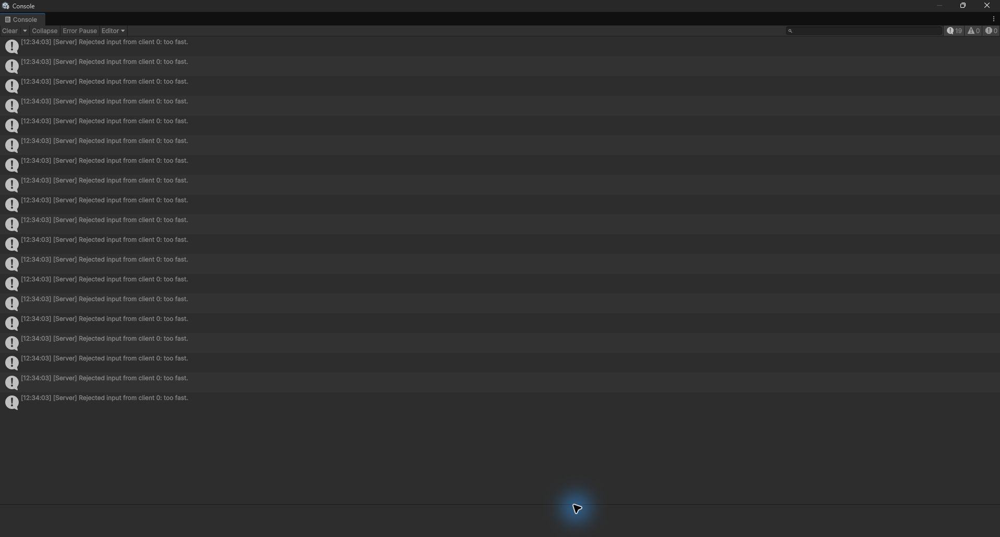

# Week 4 - The server decides

**Student:** Can Mutluşahinoğlu

**Student ID:** 2400004837

## What changed

In Homework 1 my client moved its paddle and sent the position. Now it sends only an input axis, and the server moves the paddle once per tick. Both Paddle and Ball have Client Authoritative turned off. The tick rate is still 30, and I kept the same simple court and connection HUD.

## Step 1 - Client authority off

Paddle.prefab now has Client Authoritative off and Send To Owner on. Ball.prefab was already server-authoritative. The owner receives the server's paddle position just like the other clients do. The server refreshes NetworkTransform after each movement tick, including idle ticks, so a local teleport cannot stay on screen just because the server paddle has stopped.

## Step 2 - Input up, position down

OnStartNetwork subscribes to TimeManager.OnTick, and OnStopNetwork removes the subscription. In OnTick, the owner reads W/S or the arrow keys and sends ServerSetAxis, including when the axis is zero. The server stores the accepted axis and moves the paddle with `speed * TimeManager.TickDelta`, then clamps it inside the court. Update handles serving and the three required debug keys; it no longer performs normal paddle movement.

The test used one server, two player clients and an extra spectator process on the same computer. From ten readings of each client's HUD RTT value, the median was **7 ms for LEFT** and **7 ms for RIGHT**. These are local measurements, not an Internet or two-laptop measurement. The local paddle now waits for the server result, so it can feel slightly later than the client-controlled version.

## Step 3 - Check the input

**The server receives axis = 50. Which line keeps the speed normal, and where does it run?**

`axis = Mathf.Clamp(axis, -1f, 1f);` changes 50 to 1 inside ServerSetAxis, on the server. The server then uses that value with its own speed setting. It also rejects NaN before using the number, and it refuses input from a spectator. I kept the normal ServerRpc ownership check, so one client cannot send movement for someone else's paddle.

## Step 4 - The 30 ms limit

**Why 30 ms?** At 30 ticks per second, normal input arrives about every 33.3 ms. A 30 ms minimum gap allows that input while rejecting several requests handled in the same tick. The time comes from the server's `TimeManager.TicksToTime(TimeManager.Tick)`.

**What would 5 ms do?** It is a weaker real-time limit. In this exact implementation the clock is quantized to ticks, so at 30 Hz both 5 ms and 30 ms still reject requests in the same tick. A 5 ms limit would allow much more frequent input if the clock or tick rate had finer resolution.

**What would 500 ms do?** The server would accept a new input only about twice a second. It would keep moving with the old axis between accepted requests, making stopping and changing direction feel late. It would not change the server's configured movement speed.

The timestamp is an instance field on each paddle, not a static field. Spamming one paddle therefore does not use up the other player's allowance. RejectedInputs is counted and logged on the server, and the server HUD shows a separate count for each paddle. The HUD callback is removed when that paddle stops on the server.

## Step 5 - Cheating client

| Key | What the client tries | What should happen |
| --- | --- | --- |
| C | Send axis 1 twenty times in one frame | If the first request is eligible, one is accepted and nineteen are rejected. Movement stays at normal speed. |
| X | Send axis 50 once | The server clamps it to 1. It can also be rejected if a normal input already used that tick. |
| T | Move the local paddle to the ball without an RPC | The server paddle and its collisions are unchanged; authoritative updates correct the local copy. |

**1. C sends twenty inputs and the server accepts one. Why is the paddle not twenty times faster?**

The RPC stores an axis; it does not move the paddle. The server moves the paddle once in OnTick using its speed and tick delta. Nineteen extra requests in the same tick are rejected before changing the stored input.

**2. T moved the paddle on my screen. Why did the server ball not notice?**

Only the local copy moved. No RPC asked the server to move it, and the paddle's NetworkTransform no longer trusts client positions. The ball checks the server's paddle copy, which stayed in its original lane.

**3. Which cheats would still fail without the rate limit?**

X would still fail because the axis is clamped, and T would still fail because the server controls position. C would no longer produce the rate-limit rejections, so the server would process unnecessary requests. Even then, this RPC only overwrites an axis, so twenty calls would not directly cause twenty movement steps.

## Checks and evidence

The final Unity 6000.3.2f1 development build passed these local checks:

| Check | Result |
| --- | --- |
| Owner movement reaches both clients | Passed |
| Zero input stops movement | Passed |
| Both players can move independently and stay inside the court | Passed |
| One C burst | Nineteen extra rejected inputs; stored axis stays at 1 |
| X / axis 50 | Stored axis is 1 and the server movement speed remains normal |
| NaN | Axis and accepted-input timestamp stay unchanged |
| Infinite input | Clamped to a finite axis of 1 |
| Spectator input | Refused without changing the input timestamp |
| Input sent for another owner's paddle | Refused by the RPC ownership check |
| One player's spam while the other moves | The other player's input is still accepted |
| T while stopped and while moving | Server position stays in its lane and the owner copy is corrected |
| Serve, goal and shared score | Passed |
| Disconnect and reconnect | Score restored; rejected-input HUD panels do not accumulate |

For the screenshot, I cleared the server Console and ran one isolated C burst, with regular tick-input traffic paused in the test setup so it would not add unrelated rejections. The counter went from **9 to 28**, which is **+19**. The picture shows the nineteen actual rejection entries, with no Console warnings or errors.

In normal play the C burst can share a server tick with a regular input packet. That can add another rejection or make the first debug request ineligible; it does not let any extra movement through.

The required C/X/T keys stay in PaddleController. Test drivers and build tools used for verification stay outside the submitted Unity project. No control instructions or extra cheat buttons were added to the game UI.

## Terms to explain at the demo

| Term | My explanation |
| --- | --- |
| Authority | Which machine is allowed to decide a particular part of the game state. |
| Server-authoritative | The server decides the position and sends the result to clients, including the owner. |
| Input validation | Checking that a request contains a usable value and that the caller is allowed to make it. |
| Rate limit | A rule that refuses requests arriving more often than the allowed interval. |
| Ownership | The connection assigned to an object. Owning the paddle lets me send its input RPC; it does not let me choose its server position. |

## Code questions

| Line or method | What I would say |
| --- | --- |
| `if (!IsOwner) return;` | Only the local owner reads the serve and debug keys. |
| `TimeManager.OnTick += OnTick` | Run the input and movement logic on the networking tick. |
| `ServerSetAxis(axis)` | The owner sends input to the server, including zero to stop. |
| `if (float.IsNaN(axis)) return;` | Reject a value that would make movement calculations invalid. |
| `Mathf.Clamp(axis, -1f, 1f)` | Do not let a client choose a larger movement multiplier. |
| `if (Side.Value == Spectator) return;` | A spectator cannot supply movement input. |
| `TimeManager.TicksToTime(TimeManager.Tick)` | Read time from the server's current networking tick. |
| `_lastInputTime` | Remember the most recent accepted input for this paddle's owner. |
| `now - _lastInputTime < MinInputGap` | Check whether this request arrived too soon after the accepted one. |
| `RejectedInputs++` | Count a request refused by the rate limit. |
| `_lastInputTime = now` | Update the timestamp only when accepting a request. |
| `_serverAxis = axis` | Store the input that the server will use on its movement tick. |
| `Court.ClampPaddle(transform)` | Keep the server's paddle position inside the playable area. |
| `networkTransform.ForceSend()` | Refresh the authoritative position even when the paddle is idle, so a client-only teleport is corrected. |

